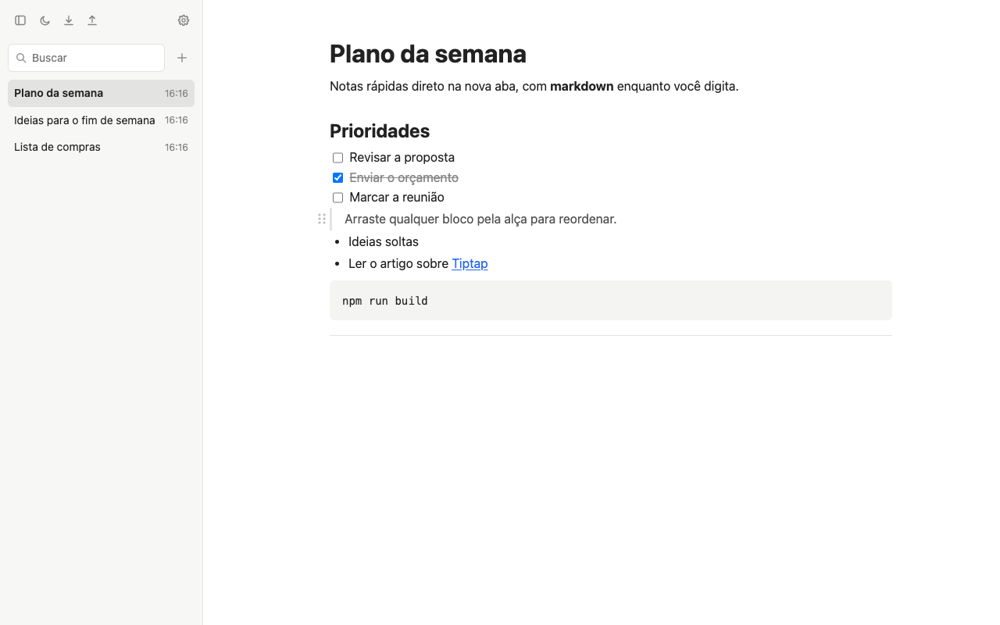
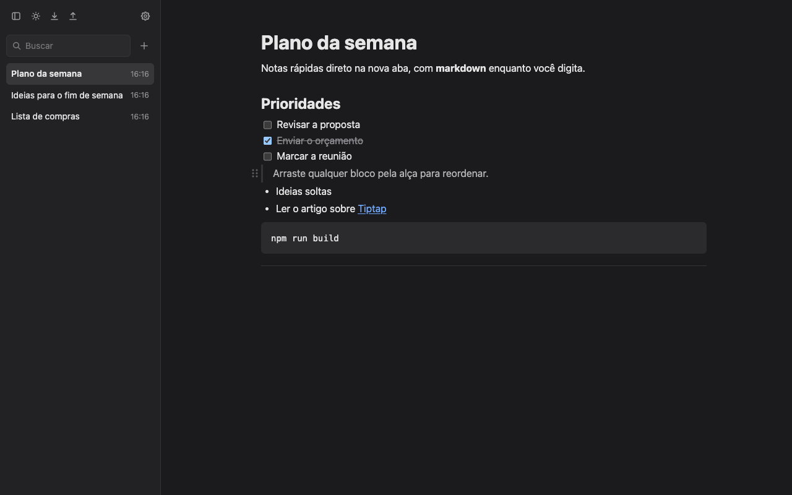

# Draftab

Extensão do Chrome que transforma a **nova aba** num bloco de notas local. O editor é feito de blocos: você digita markdown e ele vira formatação na hora, e pode **arrastar qualquer bloco** para reordenar. Tudo fica guardado no seu navegador, com backup em JSON (manual e automático).



<details>
<summary>Tema escuro</summary>



</details>

## Recursos

- **Nova aba = nota nova**, com o cursor já no editor. Nota em branco não é salva: abrir e fechar a aba não deixa lixo.
- **Markdown enquanto digita**: títulos, listas, checklist, citação, código, divisor, negrito, itálico, código inline e links (tabela abaixo).
- **Arrastar para reordenar**: passe o mouse num bloco e arraste a alça (⠿) à esquerda. Os outros blocos deslizam para abrir espaço.
  - Itens de lista têm alça própria; uma barra fina à esquerda da lista move a lista inteira.
  - Itens e parágrafos entram e saem de listas: na borda de uma lista, puxar o mouse para a esquerda tira o item, para a direita põe dentro.
- **Barra lateral recolhível** com as notas por última edição, busca no título e no conteúdo (sem diferenciar acentos), renomear e excluir.
- **Título automático**: enquanto a nota não é renomeada, o título acompanha a primeira linha.
- **Várias abas ao mesmo tempo**: o que você escreve numa aba aparece nas outras.
- **Backup**: exportar e importar um arquivo JSON com todas as notas e configurações (cada nota vai também em markdown, legível sem o Draftab).
- **Backup automático** em `Downloads/draftab-backups/`: a cada minuto, hora, dia, semana ou mês, só quando alguma nota mudou. Funciona com a aba fechada, enquanto o Chrome estiver aberto.
- **Tema claro, escuro ou automático** (segue o sistema), com um botão para trocar rápido.
- **Privacidade**: nada sai do seu computador. A extensão não acessa a internet, não tem conta nem coleta dados.

### Atalhos de markdown

| Digite | Vira |
|---|---|
| `# `, `## `, `### ` | Título de nível 1, 2 ou 3 |
| `- ` ou `* ` | Lista com marcadores |
| `1. ` | Lista numerada |
| `[ ] ` ou `- [ ] ` | Checklist (`[x] ` cria o item já marcado) |
| `> ` | Citação |
| ` ``` ` + espaço | Bloco de código |
| `---` | Divisor |
| `**texto**` | **Negrito** |
| `*texto*` | *Itálico* |
| `` `texto` `` | `Código` |
| `[texto](endereço)` | Link (abre com Cmd/Ctrl + clique) |

Endereços colados ou digitados (`https://...`) também viram link. Em listas, **Tab** recua o item.

## Instalar

O Draftab ainda não está na Chrome Web Store. Para usar, gere a extensão a partir do código:

1. Instale o [Node.js](https://nodejs.org) (20.19+ ou 22.12+; a versão LTS atual serve) e tenha o Google Chrome.
2. Baixe o código e gere a extensão:
   ```sh
   git clone <endereço-deste-repositório>
   cd draftab
   npm install
   npm run build
   ```
3. Abra `chrome://extensions`, ligue o **Modo do desenvolvedor** (canto superior direito), clique em **Carregar sem compactação** e escolha a pasta `dist/`.
4. Abra uma nova aba.

Para atualizar depois: `git pull`, `npm run build` e clique em ↻ no cartão do Draftab em `chrome://extensions`.

> **Importante:** as notas ficam guardadas na extensão. **Desinstalar o Draftab apaga todas as notas.** Exporte um backup antes de desinstalar ou trocar de computador.

### Backup automático e a pergunta de onde salvar

Se a opção do Chrome **"Perguntar onde salvar cada arquivo antes de fazer download"** estiver ligada (`chrome://settings/downloads`), o Chrome vai abrir essa pergunta a cada backup automático. Para backups silenciosos, desligue essa opção.

## Desenvolvimento

### Stack

- **Chrome Extension Manifest V3** (`chrome_url_overrides.newtab` + service worker).
- **TypeScript** estrito, **sem framework de UI** (sem React e afins): a interface em volta do editor é pequena e escrita direto no DOM.
- **[Tiptap 3](https://tiptap.dev)** (sobre ProseMirror) para o editor, com `StarterKit`, `TaskList/TaskItem`, `DragHandle` e `@tiptap/markdown` (só para exportar).
- **[Vite](https://vite.dev)** para o build e **[Vitest](https://vitest.dev)** para os testes.

### Comandos

| Comando | O que faz |
|---|---|
| `npm install` | Instala as dependências |
| `npm run dev` | Build em modo *watch*: reconstrói a cada mudança (depois, ↻ na extensão e reabrir a aba) |
| `npm run build` | Confere os tipos e gera a extensão em `dist/` |
| `npm test` | Roda os testes (Vitest) |

### Estrutura

```
public/
  manifest.json          manifest da extensão (copiado para dist/)
  tema-inicial.js        aplica o tema antes de a página aparecer (evita piscar)
newtab.html              página da nova aba (editor, barra lateral, lightbox de Configurações)
src/
  newtab.ts              lógica da aba: abrir/salvar notas, barra lateral, sincronização entre abas
  editor.ts              cria o editor Tiptap: atalhos extras, links, alça de arrastar
  extensoes.ts           extensões de conteúdo (blocos e marcas), compartilhadas com o backup
  reordenar.ts           arrastar e soltar animado, entre níveis (listas, itens, parágrafos)
  alca-lista.ts          alça que move uma lista inteira
  notas.ts               modelo da nota e regras puras (título, nota vazia, busca)
  storage.ts             único ponto de acesso ao chrome.storage
  backup.ts              formato do arquivo de backup: criar, validar, restaurar
  backup-ui.ts           exportar (download) e importar (escolher arquivo) a partir da página
  backup-automatico.ts   decide e faz o backup automático (roda no service worker)
  background.ts          service worker: alarmes do backup automático
  configuracoes.ts       lightbox de Configurações
  tema.ts                tema claro/escuro/automático
  icones.ts              ícones SVG
  newtab.css             estilos (as cores ficam em variáveis no topo, uma vez por tema)
  *.test.ts              testes; chrome-falso.ts simula o chrome.storage nos testes
docs/capturas/           imagens deste README
```

### Como os dados são guardados

- Tudo vai para `chrome.storage.local` (com a permissão `unlimitedStorage`), sempre através de `src/storage.ts`.
- **Uma chave por nota** (`note:<id>`), para não regravar tudo a cada tecla. A nota guarda o **JSON do Tiptap**, que é a fonte da verdade; markdown só existe na exportação.
- `settings` guarda as configurações (intervalo do backup automático, barra recolhida, tema) e `meta` guarda horários: última mudança, último backup automático e última importação (que faz as abas abertas recarregarem).
- O salvamento é automático, com espera de ~500 ms sem digitar. As outras abas recebem a mudança por `chrome.storage.onChanged`; se duas abas editam a mesma nota, a última gravação vence.
- O formato completo (nota, configurações, arquivo de backup) está descrito no [SPEC.md](SPEC.md).

### Permissões

| Permissão | Para quê |
|---|---|
| `storage` | Guardar notas e configurações no navegador |
| `unlimitedStorage` | Não ficar preso ao limite de ~10 MB do `chrome.storage.local` |
| `alarms` | Acordar o service worker no horário do backup automático |
| `downloads` | Salvar o arquivo do backup automático em `Downloads/draftab-backups/` |

Novas permissões só entram com motivo registrado no SPEC.md.

### Testes

`npm test` cobre a camada de dados e o backup: salvar/ler/listar/excluir notas, configurações, regras de título e busca, exportar → importar sem perdas, recusa de arquivos de backup inválidos e as decisões do backup automático. O `chrome.storage`, os alarmes e os downloads são simulados em `src/chrome-falso.ts`.

O editor (atalhos, arrastar, aparência) é verificado à mão no Chrome, seguindo o "Como verificar" de cada etapa do [PLAN.md](PLAN.md).

### Documentos do projeto

| Arquivo | Conteúdo |
|---|---|
| [SPEC.md](SPEC.md) | O que o Draftab faz e por quê: escopo, decisões técnicas, modelo de dados |
| [PLAN.md](PLAN.md) | Etapas de desenvolvimento, como verificar cada uma e o status |
| [FEATURES.md](FEATURES.md) | Backlog de ideias de features, por área, com status |
| [CLAUDE.md](CLAUDE.md) | Instruções e convenções do projeto para o [Claude Code](https://claude.com/claude-code) (também valem para humanos) |

### Convenções

- Código direto e legível, preferido a abstrações; comentários e textos da interface em **português**.
- Todo acesso ao `chrome.storage` passa por `src/storage.ts`.
- Mudança de decisão vai primeiro para o SPEC.md; ideias novas vão para o FEATURES.md.

## Contribuir

Contribuições são bem-vindas. Para propor uma mudança:

1. Abra uma *issue* descrevendo o problema ou a ideia (ideias também podem entrar no [FEATURES.md](FEATURES.md)).
2. Faça um *fork*, crie um branch e mantenha as convenções acima.
3. Confira que `npm run build` e `npm test` passam, e teste no Chrome o que mudou.
4. Abra um *pull request* explicando o que mudou e como verificar.

### Limitações conhecidas

- As notas existem só neste navegador; não há sincronização entre computadores (o backup JSON cobre a transferência manual).
- **Shift+Tab** ainda não recua itens de lista: em vez disso, o Chrome troca de aba ([registrado no backlog](FEATURES.md)).

## Licença

[MIT](LICENSE) © 2026 Ramon K.

Você pode usar, copiar, modificar, juntar com outros projetos, publicar, distribuir, sublicenciar e vender cópias do Draftab, inclusive em projetos comerciais. A única exigência é manter o aviso de copyright e o texto da licença (o arquivo [LICENSE](LICENSE)) nas cópias ou em partes relevantes do código: esses são os créditos. O software é fornecido "como está", sem garantias.
