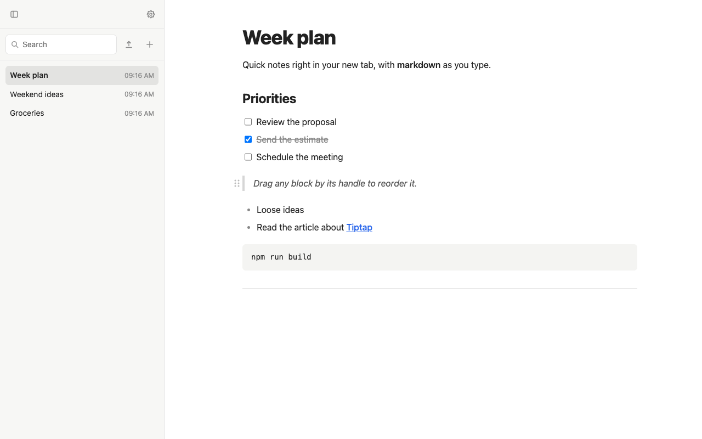
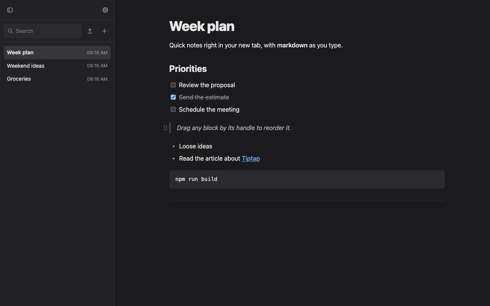

# Draftab

A Chrome extension that turns the **new tab** into a local notepad. The editor is made of blocks: you type markdown and it becomes formatting right away, and you can **drag any block** to reorder it. Everything is stored in your browser, with JSON backups (manual and automatic).



<details>
<summary>Dark theme</summary>



</details>

## Features

- **New tab = new note**, with the cursor already in the editor. A blank note isn't saved: opening and closing a tab leaves no clutter.
- **Markdown as you type**: headings, lists, checklists, quotes, code, dividers, bold, italic, inline code and links (table below). Backspace at the start of a code block or quote turns it back into normal text.
- **Drag to reorder**: hover a block and drag the handle (⠿) on its left. The other blocks slide to make room.
  - List items have their own handle; a thin bar to the left of a list moves the whole list.
  - Items and paragraphs move in and out of lists: at the edge of a list, pulling the mouse left takes the item out, pulling right puts it in.
- **Collapsible sidebar** with your notes sorted by last edit, title or creation date (your choice in Settings), search across title and content (accent-insensitive), rename and delete.
- **Export and copy the open note** with the buttons at the top right: a Markdown `.md` file, or the whole note on the clipboard (formatted, and as markdown for plain-text apps).
- **Text size per note**: A− / A+ at the top right (or Cmd/Ctrl+Shift+, and Cmd/Ctrl+Shift+.) from 80% to 150%; each note keeps its own size, and Settings sets the size new notes start with.
- **Character counts** at the bottom right: the note's characters with markdown, without markdown, and how many are selected.
- **Import a file as a note**: the import icon next to the New note button turns a `.md` (read as markdown) or `.txt` (one paragraph per line) file into a new note.
- **Automatic title**: until the note is renamed, its title follows the first line.
- **Several tabs at once**: what you write in one tab shows up in the others.
- **Backup** (in Settings): export and import a JSON file with all notes and settings (each note also goes in markdown, readable without Draftab).
- **Automatic backup** to `Downloads/draftab-backups/`: every minute, hour, day, week or month, only when some note changed. Works with the tab closed, as long as Chrome is open.
- **Copy a block with a double-click** on its handle (or a whole list on its bar): it's selected and copied, formatted and as plain text.
- **Light, dark or automatic theme** (follows the system), chosen in Settings.
- **Note font**: sans-serif, serif or monospace, with typography modeled on [Tailwind Typography](https://github.com/tailwindlabs/tailwindcss-typography).
- **Privacy**: nothing leaves your computer. The extension doesn't access the internet, has no account and collects no data.

### Markdown shortcuts

| Type | Becomes |
|---|---|
| `# `, `## `, `### ` | Heading level 1, 2 or 3 |
| `- ` or `* ` | Bulleted list |
| `1. ` | Numbered list |
| `[ ] ` or `- [ ] ` | Checklist (`[x] ` creates an already checked item) |
| `> ` | Quote |
| ` ``` ` + space | Code block |
| `---` | Divider |
| `**text**` | **Bold** |
| `*text*` | *Italic* |
| `` `text` `` | `Code` |
| `[text](address)` | Link (opens with Cmd/Ctrl + click) |

Pasted or typed addresses (`https://...`) also become links. In lists, **Tab** indents the item.

## Install

Draftab has been submitted to the Chrome Web Store and will be linked here once it's live. Meanwhile, build the extension from the source:

1. Install [Node.js](https://nodejs.org) (20.19+ or 22.12+; the current LTS works) and have Google Chrome.
2. Get the code and build the extension:
   ```sh
   git clone https://github.com/ramonk2o/draftab.git
   cd draftab
   npm install
   npm run build
   ```
3. Open `chrome://extensions`, turn on **Developer mode** (top-right corner), click **Load unpacked** and choose the `dist/` folder.
4. Open a new tab.

To update later: `git pull`, `npm run build` and click ↻ on the Draftab card in `chrome://extensions`.

> **Important:** notes are stored inside the extension. **Uninstalling Draftab deletes all notes.** Export a backup before uninstalling or switching computers.

### Automatic backup and the "where to save" question

If Chrome's **"Ask where to save each file before downloading"** option is on (`chrome://settings/downloads`), Chrome will ask on every automatic backup. For silent backups, turn that option off.

## Development

### Stack

- **Chrome Extension Manifest V3** (`chrome_url_overrides.newtab` + service worker).
- Strict **TypeScript**, **no UI framework** (no React or similar): the interface around the editor is small and written directly against the DOM.
- **[Tiptap 3](https://tiptap.dev)** (on top of ProseMirror) for the editor, with `StarterKit`, `TaskList/TaskItem`, `DragHandle` and `@tiptap/markdown` (export only).
- **[Vite](https://vite.dev)** for the build and **[Vitest](https://vitest.dev)** for tests.

### Commands

| Command | What it does |
|---|---|
| `npm install` | Installs dependencies |
| `npm run dev` | Build in *watch* mode: rebuilds on every change (then ↻ on the extension and reopen the tab) |
| `npm run build` | Type-checks and builds the extension into `dist/` |
| `npm test` | Runs the tests (Vitest) |
| `npm run zip` | Builds `draftab-<version>.zip` for the Chrome Web Store, with license notices (see [STORE.md](STORE.md)) |

### Structure

```
public/
  manifest.json          extension manifest (copied to dist/)
  theme-init.js          applies the theme and note font before the page shows up (avoids flashing)
  icons/                 extension icons (16, 32, 48, 128 px)
  _locales/              extension description in English and Portuguese (store summary)
newtab.html              new tab page (editor, sidebar, Settings lightbox)
src/
  newtab.ts              tab logic: opening/saving notes, sidebar, sync across tabs
  editor.ts              creates the Tiptap editor: extra shortcuts, links, drag handle
  extensions.ts          content extensions (blocks and marks), shared with the backup
  reorder.ts             animated drag and drop, across levels (lists, items, paragraphs)
  list-handle.ts         handle that moves a whole list
  copy-block.ts          double-click on a handle: select and copy the block
  unwrap-block.ts        Backspace at the start of a code block or quote turns it into text
  markdown.ts            note ↔ markdown: export a note, import a .md/.txt file
  notes.ts               note model and pure rules (title, empty note, search)
  storage.ts             the single access point to chrome.storage
  dom.ts                 finding page elements
  backup.ts              backup file format: create, validate, restore
  backup-ui.ts           downloads and file picking from a page (backup, note export)
  auto-backup.ts         decides on and makes the automatic backup (runs in the service worker)
  background.ts          service worker: automatic backup alarms
  settings.ts            Settings lightbox
  theme.ts               light/dark/automatic theme and note font
  icons.ts               SVG icons
  newtab.css             styles (colors are variables at the top, once per theme)
  *.test.ts              tests; fake-chrome.ts simulates the chrome APIs in tests
scripts/zip.mjs          builds the store package (npm run zip)
docs/screenshots/        images for this README
docs/store/              Chrome Web Store images (en and pt-BR)
```

### How data is stored

- Everything goes to `chrome.storage.local` (with the `unlimitedStorage` permission), always through `src/storage.ts`.
- **One key per note** (`note:<id>`), so not everything is rewritten on every keystroke. The note stores the **Tiptap JSON**, which is the source of truth; markdown only exists on export.
- `settings` holds the settings (automatic backup interval, collapsed sidebar, theme, note sort order, note font) and `meta` holds timestamps: last change, last automatic backup and last import (which makes open tabs reload).
- The theme and note font are also copied to the page's `localStorage`, so they're applied before the first paint; the note open in each tab is kept in its `sessionStorage`, so a reload reopens it.
- Saving is automatic, after ~500 ms without typing. Other tabs get the change through `chrome.storage.onChanged`; if two tabs edit the same note, the last write wins.
- The full format (note, settings, backup file) is described in [SPEC.md](SPEC.md).

### Permissions

| Permission | What for |
|---|---|
| `storage` | Store notes and settings in the browser |
| `unlimitedStorage` | Not be limited to the ~10 MB of `chrome.storage.local` |
| `alarms` | Wake the service worker at the automatic backup time |
| `downloads` | Save the automatic backup file to `Downloads/draftab-backups/` |

New permissions are only added with a reason recorded in SPEC.md.

### Tests

`npm test` covers the data layer and backups: saving/reading/listing/deleting notes, settings, title and search rules, lossless export → import, rejection of invalid backup files and the automatic backup decisions. `chrome.storage`, alarms and downloads are simulated in `src/fake-chrome.ts`.

The editor and the interface (shortcuts, dragging, appearance) are checked in Chrome, following each stage's "How to verify" in [PLAN.md](PLAN.md).

### Project documents

| File | Contents |
|---|---|
| [SPEC.md](SPEC.md) | What Draftab does and why: scope, technical decisions, data model |
| [PLAN.md](PLAN.md) | Development stages, how to verify each one and their status |
| [FEATURES.md](FEATURES.md) | Feature idea backlog, by area, with status |
| [CHANGELOG.md](CHANGELOG.md) | What changed in each version |
| [STORE.md](STORE.md) | Chrome Web Store listing texts (en-US and pt-BR), privacy answers and how to submit or update |
| [PRIVACY.md](PRIVACY.md) | Privacy policy (English and Portuguese) |
| [CLAUDE.md](CLAUDE.md) | Project instructions and conventions for [Claude Code](https://claude.com/claude-code) (they apply to humans too) |

### Conventions

- Direct, readable code over abstractions; everything (code, comments, UI text, docs) in **English**.
- All `chrome.storage` access goes through `src/storage.ts`.
- Changes of decision go to SPEC.md first; new ideas go to FEATURES.md.

## Contributing

Contributions are welcome. To propose a change:

1. Open an *issue* describing the problem or the idea (ideas can also go into [FEATURES.md](FEATURES.md)).
2. *Fork* the repo, create a branch and follow the conventions above.
3. Make sure `npm run build` and `npm test` pass, and test what changed in Chrome.
4. Open a *pull request* explaining what changed and how to verify it.

### Known limitations

- Notes only exist in this browser; there's no sync across computers (the JSON backup covers moving them manually).
- **Shift+Tab** doesn't outdent list items yet: Chrome switches tabs instead ([recorded in the backlog](FEATURES.md)).

## License

[MIT](LICENSE) © 2026 Ramon K.

You may use, copy, modify, merge with other projects, publish, distribute, sublicense and sell copies of Draftab, including in commercial projects. The only requirement is keeping the copyright notice and the license text (the [LICENSE](LICENSE) file) in copies or substantial portions of the code: that's the credit. The software is provided "as is", without warranty.
